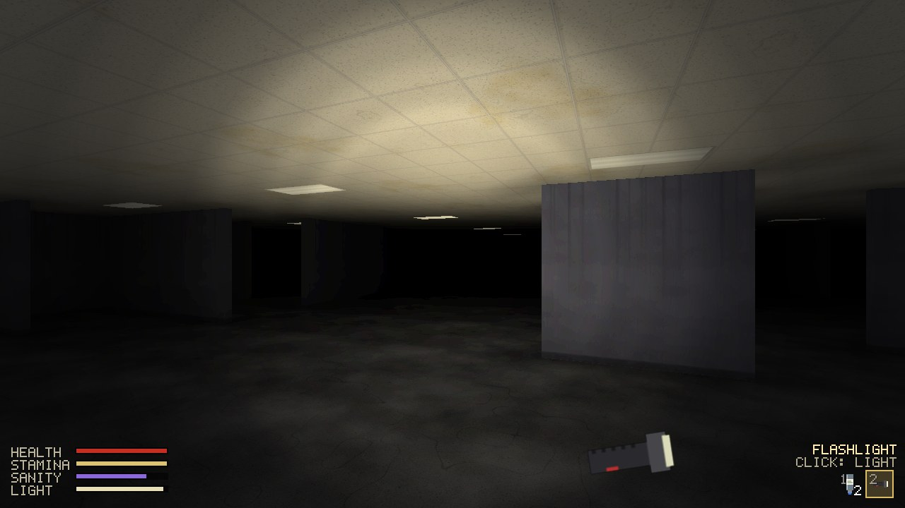
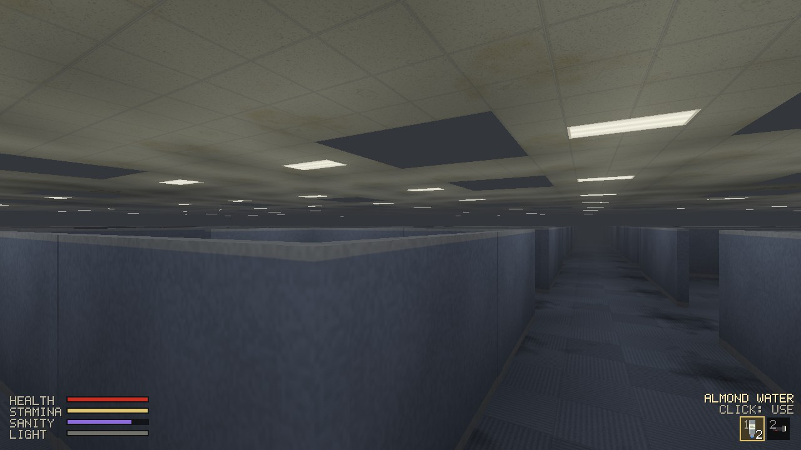
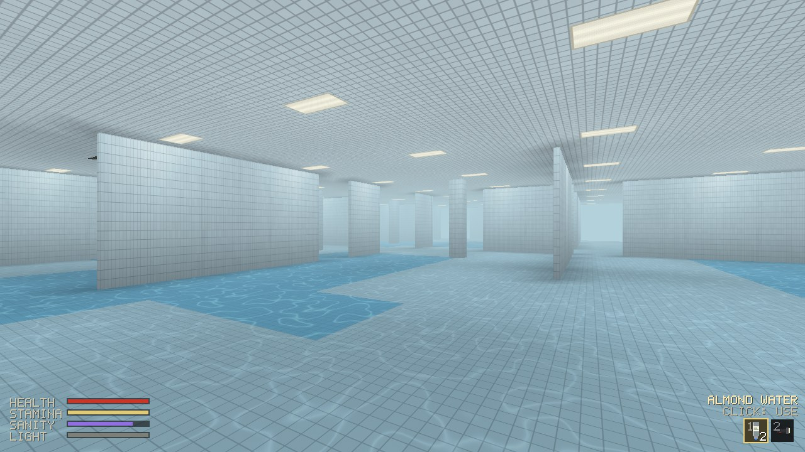
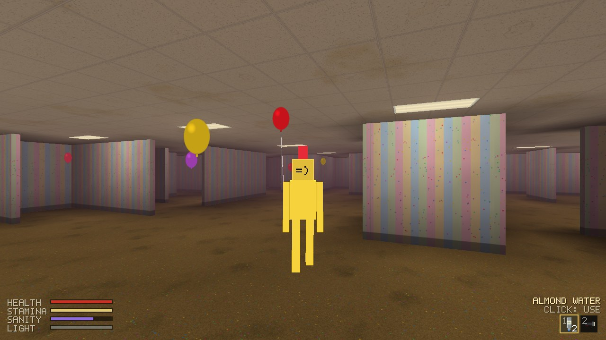
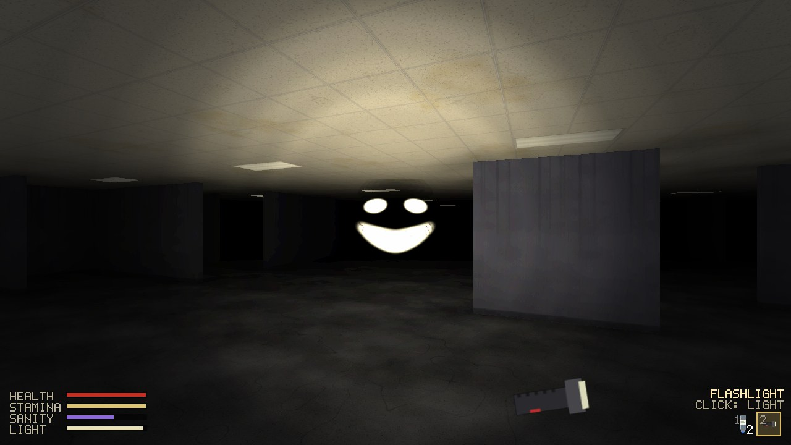
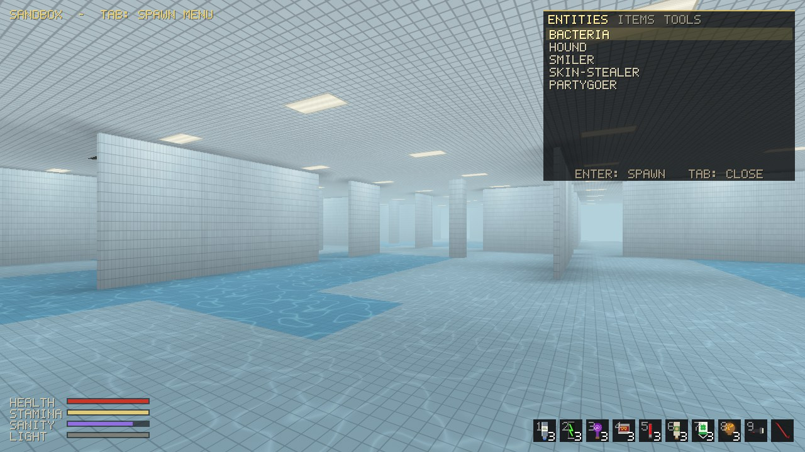
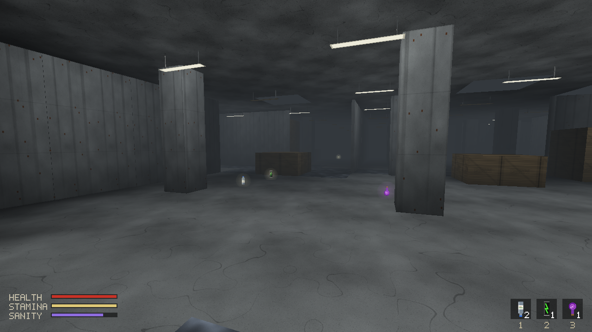
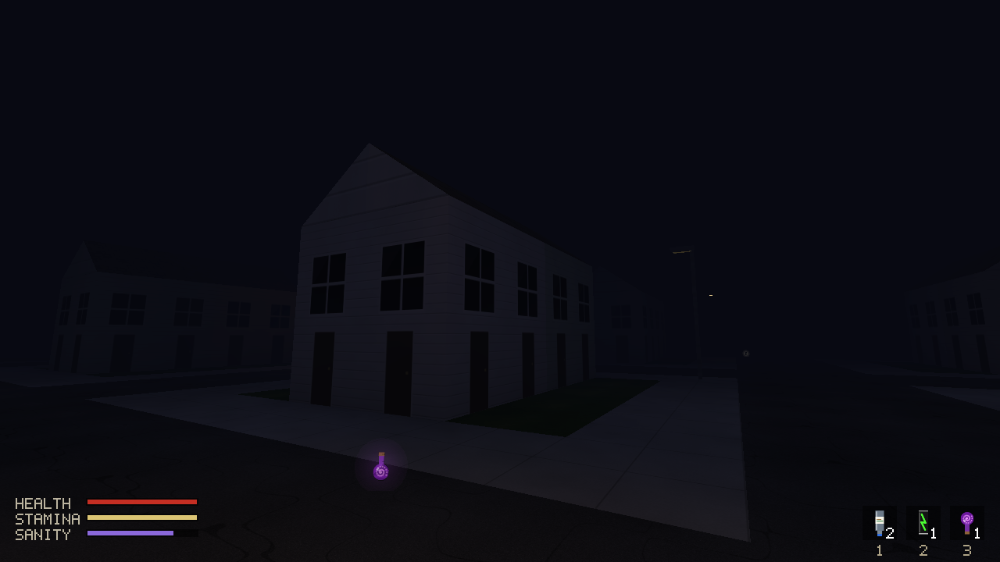
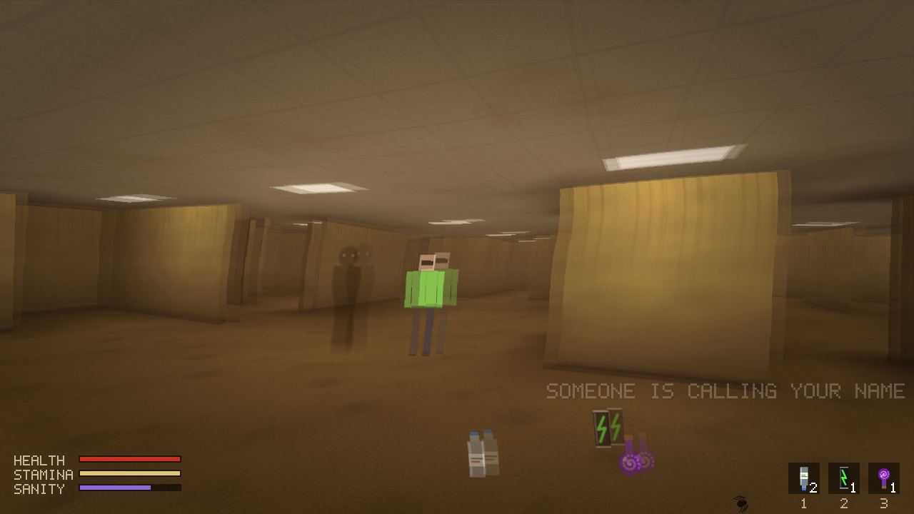

# Backrooms Iris

Open-source co-op Backrooms horror. Up to 4 players, PvE: survive, keep your head together, find the exit.
One C++ codebase for **Linux, Windows and PS Vita**, plus a headless dedicated server for **FreeBSD**.



> Inspired by Backrooms games and the community wiki lore. All code, art and sound are original and generated
> in code: no assets, maps or art copied from any other game.

## What's in 0.3

| | |
|---|---|
| **5 new levels** | Level 2 Pipe Dreams, Level 4 Abandoned Office, Level 6 Lights Out, Level 37 Sublimity (poolrooms), Level Fun =) |
| **7 new items** | Flashlight, Crowbar, Royal Ration, Liquid Pain, Cashew Water, Lucky O' Milk, Firesalt |
| **Hotbar** | pick any item with 1-9 / mouse wheel / D-pad, use it with left click / Square |
| **Sandbox mode** | spawn any entity or item, god mode, noclip, freeze or clear entities, jump to the exit or next level |
| **Textures** | redone without seams or stretching; every new level has its own set |
| **Fixes** | pause menu no longer turns the level into Level 0; items can always be picked up; plus a pile of smaller ones (see below) |

### Bugs fixed in 0.3

- **Pause menu made everything Level 0.** The menu background re-pointed the renderer at the title screen world.
  Pausing now draws the real game behind the menu and never touches the level.
- **Items sometimes couldn't be picked up.** The server compared your pickup counter with a stale value after a
  level change or reconnect, so the first press(es) were thrown away. Counters now reset with the session and the
  server takes a fresh baseline. Pickup range is a bit bigger too.
- Texture seams, mirrored signs, stretched walls on low and tall surfaces, z-fighting on lights.
- Chunk meshes build on a background thread, so walking into new areas no longer hitches.
- Entities could spawn in plain sight in open levels; snapshots could drop nearby entities with lots of players.

## What was in 0.2

| | |
|---|---|
| **6 levels** | Level 0 The Lobby, Level 1 Habitable Zone, Level 5 Terror Hotel, Level 8 Cave System, Level 9 The Suburbs, Level 11 The Endless City |
| **5 entities** | Bacteria, Hounds, Smilers, Skin-Stealers, Partygoers |
| **Items** | Almond Water, Energy Drink, Memory Juice |
| **Sanity** | drains in the dark, near entities and over time; low sanity messes with your eyes; zero sanity hurts |
| **Menus** | single player / multiplayer, settings (mouse + stick sensitivity, invert, FOV, head bob, fullscreen, vsync), controls |
| **Multiplayer** | host from inside the game or run the FreeBSD server; LAN browser; join by IP; PC and Vita in the same game |
| **Vita** | full build target: same game, same menus, controller-only UI, LiveArea art |

## Levels

Every level is endless and generated from a seed, so the same seed gives the same world on every machine.
Find the glowing green **EXIT** sign: the door takes everyone to the next level.

| level | what it is | who lives there |
|---|---|---|
| **0 - The Lobby** | mono-yellow rooms, damp carpet, buzzing lights, some dead | Bacteria, a Smiler in the dark |
| **1 - Habitable Zone** | huge concrete warehouse, columns, crates, puddles, misty, whole sections without power | Hounds, Bacteria |
| **5 - Terror Hotel** | endless corridors of guest rooms, red carpet, wood panels, ballrooms | Partygoers, a Smiler |
| **8 - Cave System** | pitch-black caves, lumpy ceilings, glowing fungus. You see a few metres | Smilers, Hounds |
| **9 - The Suburbs** | streets of identical houses at night, half the streetlights dead | Skin-Stealers, Hounds |
| **2 - Pipe Dreams** | narrow maintenance tunnels, pipes everywhere, hot boiler rooms, caged bulbs | Hounds, Bacteria, a Smiler |
| **4 - Abandoned Office** | empty cubicle farm, desks, fluorescent lights, all quiet. Mostly | Bacteria |
| **6 - Lights Out** | every light is dead. Bring a flashlight (there's one where you spawn) | Smilers. Lots of them |
| **37 - Sublimity** | the poolrooms: white tile, warm water, sunlight from nowhere. **Safe** | nobody |
| **Fun =)** | party rooms, balloons, confetti carpet. It is not fun | Partygoers |
| **11 - The Endless City** | grey daytime city, endless towers. **Safe**: sanity recovers here | nobody |

Exit order: 0 → 1 → 2 → 4 → 5 → 6 → 8 → 9 → 37 → Fun → 11 → back to 0. Of course it loops.

## Entities

| | how it acts | how to live |
|---|---|---|
| **Bacteria** | tall, thin, black. Freezes for a second when it spots you, then runs you down. Faster than your sprint in a straight line, but it turns slowly | break line of sight: corners, doorways. One touch kills |
| **Hounds** | hunt by **sound**: sprinting is loud, walking less, crouching is nearly silent | look them in the eye and don't run: they hesitate and back off. Turn your back and they lunge |
| **Smilers** | a grin in the dark, nothing else. Drifts closer while you're not looking | don't stare at it, don't sprint near it, get to the light. Looking too long makes it charge |
| **Skin-Stealers** | patrol the streets of Level 9, chase on sight, hit hard | a full sprint barely outpaces them. Energy drinks help |
| **Partygoers** | `=)` They want you at the party. Slower than you, but they never stop following | keep moving and find the exit. Being touched is final |

## Items

| | |
|---|---|
| **Almond Water** | refills stamina and restores a chunk of sanity |
| **Energy Drink** | ~14 s of moving much faster with no stamina cost, then a crash |
| **Memory Juice** | don't. A long deliriant trip: shadow people, things on the floor that aren't there, a "friend" standing there staring, spiders on your eyes, whispers, double vision, then the dark closes in. Then you die |

| **Flashlight** | toggle with F / Triangle. The battery runs ~3 min and recharges when off. Smilers hate it |
| **Crowbar** | swing it: knocks entities down for a few seconds. Doesn't kill anything |
| **Royal Ration** | heals a lot |
| **Liquid Pain** | hurts going down (costs health) but clears your head (big sanity boost) |
| **Cashew Water** | cures memory juice if you drink it early enough, but slows you down for a while |
| **Lucky O' Milk** | ~35 s of being much quieter: Hounds and others barely hear you |
| **Firesalt** | throw it: burns for ~40 s and lights the area up. Entities keep away from the fire |

Everyone starts with one Almond Water, and Levels 0, 6 and 8 have a flashlight right next to where you spawn.
Drinks stack up to 5; tools (flashlight, crowbar) don't stack. Dying drops your items.

## Sandbox

Main menu → **Sandbox**, pick a level, then press **Tab** (Select on Vita) in game:

- **Entities**: spawn any of the 5 in front of you
- **Items**: spawn any item at your feet
- **Tools**: god mode, noclip, auto spawning on/off, freeze entities, clear all entities, heal, go to the nearest exit, next level


## Screenshots

0.3:

| | |
|---|---|
|  |  |
|  |  |
|  |  |
|  |  |

0.2:

| | |
|---|---|
|  |  |
|  |  |
|  |  |
|  |  |
|  |  |
|  |  |
|  |  |

---

## Arch Linux

### 1. Install the tools

```bash
sudo pacman -S --needed base-devel git cmake ninja sdl2-compat mesa
```

`sdl2-compat` is Arch's SDL2 package now (it replaced `sdl2`). If pacman asks to replace `sdl2`, say yes.

### 2. Build

From the `backrooms-iris` folder:

```bash
cmake -S . -B build -G Ninja
```

```bash
cmake --build build
```

### 3. Play

```bash
./build/backrooms-iris
```

Optional: `ctest --test-dir build` runs the world, sim, item and network tests.

---

## Windows (10 / 11)

### 1. Install MSYS2

Download and run the installer from <https://www.msys2.org>, keep the default folder (`C:\msys64`).

### 2. Install the tools

Open **"MSYS2 UCRT64"** from the Start menu (that exact one) and run:

```bash
pacman -S --needed git mingw-w64-ucrt-x86_64-gcc mingw-w64-ucrt-x86_64-cmake mingw-w64-ucrt-x86_64-ninja mingw-w64-ucrt-x86_64-SDL2
```

### 3. Build

```bash
cd /c/Users/BigG/Downloads/backrooms-iris
```

```bash
cmake -S . -B build -G Ninja
```

```bash
cmake --build build
```

### 4. Play

```bash
./build/backrooms-iris.exe
```

`SDL2.dll` is copied next to the `.exe`. To play on another PC, copy both files.
The first time you host a game, Windows Firewall asks about network access: allow it on private networks.

---

## PS Vita

Same game, same menus. Controls on the Vita: left stick move, right stick look, R sprint, Circle crouch,
Cross pick up / select, D-pad left/up/right use items, Start pause.

### 1. Install VitaSDK (on Arch)

```bash
sudo pacman -S --needed base-devel cmake git curl python
```

```bash
git clone https://github.com/vitasdk/vdpm && cd vdpm
```

```bash
./bootstrap-vitasdk.sh
```

```bash
echo 'export VITASDK=/usr/local/vitasdk' >> ~/.bashrc && echo 'export PATH=$VITASDK/bin:$PATH' >> ~/.bashrc && source ~/.bashrc
```

```bash
./install-all.sh
```

`install-all.sh` installs every VitaSDK library, including **vitaGL** and **SDL2**.

### 2. Build the .vpk

Back in the `backrooms-iris` folder:

```bash
cmake -S . -B build-vita -DCMAKE_TOOLCHAIN_FILE=$VITASDK/share/vita.toolchain.cmake
```

```bash
cmake --build build-vita
```

Output: `build-vita/BackroomsIris.vpk`.

### 3. Run it

- **Vita3K**: `vita3k-bin` from the AUR (or the AppImage from vita3k.org), install the firmware, then
  File → Install .pkg/.zip/.vpk.
- **Real Vita**: copy the `.vpk` over with VitaShell (FTP or USB) and install it.
  vitaGL apps usually need `libshacccg.suprx` on the console. If it crashes at boot, install it with
  [ShaRKF00D](https://github.com/Rinnegatamante/ShaRKF00D) first.
- Multiplayer on the Vita: connect it to the same Wi-Fi as the PC/server, then Multiplayer → Join Game.
  The LAN browser finds games automatically, or enter the IP with the D-pad.

---

## Multiplayer

**From inside the game (easiest):** one player picks *Multiplayer → Host Game*. Everyone else on the same
network picks *Multiplayer → Join Game* and the game shows up in the list. Or type the host's IP.

**Dedicated server (your FreeBSD X230):** see below. Players join it the same way: it appears in the LAN list,
or use its IP. For friends outside your house, forward **UDP 27315** on your router to the server.

The server runs the real game (entities, items, sanity, exits); clients predict their own movement so it
feels instant even on laggy Vita Wi-Fi. Dead players respawn after 10 seconds. When anyone reaches the exit,
everyone goes to the next level.

## FreeBSD dedicated server

### 1. Get the code onto the server

```bash
pkg install git
```

```bash
git clone <your repo url> backrooms-iris && cd backrooms-iris
```

(or copy the folder over with `scp -r`)

### 2. Run the installer as root

```bash
su -m root -c 'sh server/freebsd/install.sh'
```

It's a TUI (bsddialog, which ships in FreeBSD 14's base system). Pick **Install / update** and it will:

1. `pkg install cmake ninja` if they're missing (clang is already in base)
2. ask for the server name, UDP port, max players, world seed and starting level
3. build `iris_server` from the checkout
4. install the binary, config, rc.d service, log rotation and an unprivileged `iris` user
5. start the service and check that it answers

Run it again any time to update, change settings, start/stop, read the log, or uninstall.


### 3. Day-to-day

```bash
service iris_server status
```

```bash
service iris_server restart
```

```bash
tail -f /var/log/iris_server.log
```

```bash
iris_server --query 127.0.0.1
```

| file | what |
|---|---|
| `/usr/local/etc/iris/server.conf` | settings (restart after editing) |
| `/usr/local/etc/rc.d/iris_server` | service script (a crash means auto-restart after 5 s) |
| `/var/log/iris_server.log` | log, rotated by newsyslog |

---

## Controls

| action | keyboard + mouse | gamepad / PS Vita |
|---|---|---|
| move | WASD | left stick |
| look | mouse | right stick |
| sprint | Shift | R / R2 |
| crouch | Ctrl or C (hold) | Circle / B (toggle) |
| pick up | E | Cross / A |
| use selected item / swing crowbar | left click or Q | Square / L / D-pad up |
| pick item | 1-9 or mouse wheel | D-pad left / right |
| flashlight | F | Triangle |
| sandbox spawn menu | Tab | Select |
| pause | Esc | Start |
| screenshot | F12 | |
| fullscreen | F11 or Alt+Enter | |
| fps + position (terminal) | F3 | |

Menus: arrows or mouse + Enter + Esc, or D-pad/stick + Cross + Circle. To edit a text field (name, IP, seed)
select it, then type, or use up/down to change the letter under the cursor and left/right to move.

## Command line

```
backrooms-iris [--level N] [--seed N] [--sandbox] [--host] [--join IP]
```

`--level` jumps straight into a level (0 1 2 4 5 6 8 9 11 37 fun) in single player; add `--sandbox` for sandbox mode. Settings live in
`~/.local/share/BackroomsIris/BackroomsIris/settings.cfg` (Linux), `%APPDATA%\BackroomsIris\BackroomsIris\` (Windows),
`ux0:data/BackroomsIris/` (Vita).

## Reporting bugs

1. what you did and what looked or felt wrong
2. the terminal output (press **F3** in game to add fps/position/health lines)
3. the level + seed (shown in single player setup) and a screenshot (**F12**)

## How it's built

```
src/core/       shared by everything, no SDL/GL: levels, collision, movement, entities, items, sanity, the game sim
src/net/        UDP sockets (Linux, Windows, Vita, FreeBSD), server core, client
src/client/     menus + HUD (app), sessions (single player / network), renderer, textures, effects, font
src/platform/   pc/ (SDL2 + OpenGL) and vita/ (vitaGL + SDL2 input)
src/server/     headless dedicated server
server/freebsd/ install.sh TUI, rc.d script, sample config, newsyslog rule
vita/sce_sys/   LiveArea images (regenerate: python3 tools/gen_livearea.py build/backrooms-iris)
tests/          ctest: every level, items, a 3-minute sim soak per level, a real UDP round trip
```

- **Levels aren't stored.** Every wall, room, house, light, item and exit is a pure function of `(level, seed, position)`.
- **One sim, three places.** `GameSim` runs in single player, in "Host game", and on the dedicated server.
- **Server-authoritative + prediction.** Clients send inputs (with redundancy so lost packets don't matter), predict
  their own movement with the same code the server runs, and replay unacknowledged inputs when a snapshot arrives.
- **One renderer for PC and Vita**: the OpenGL subset vitaGL implements (fixed function + VBOs + fog), everything
  drawn from procedural textures and box models. Screen warping for the memory juice is PC-only; the Vita gets
  the overlays.

## Roadmap

- [x] 1. Walk around a procedurally generated Level 0 on PC
- [~] 2. Vita build (target is complete; first hardware test is yours)
- [ ] 3. Audio (procedural hum, footsteps, growls, drones), light flicker, VHS / film grain shaders
- [~] 4. Dedicated server + LAN co-op (working; lag compensation for hits next)
- [~] 5. Online PC ↔ Vita, entities, more levels (5 entities + 11 levels + 10 items + sandbox done; carpet moss next)

## License

MIT, see [LICENSE](LICENSE).
