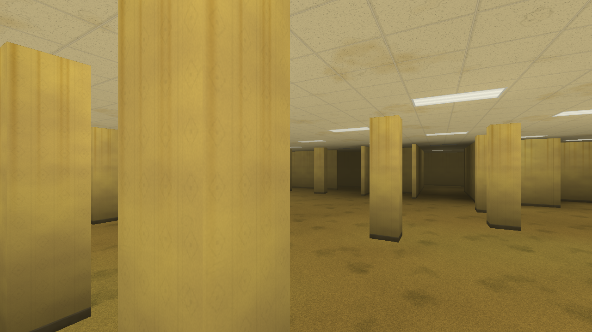
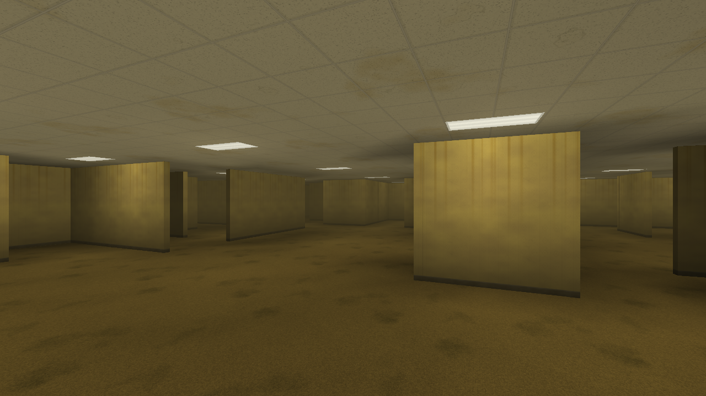
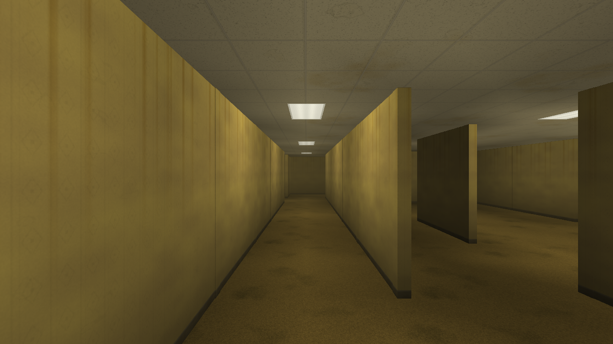
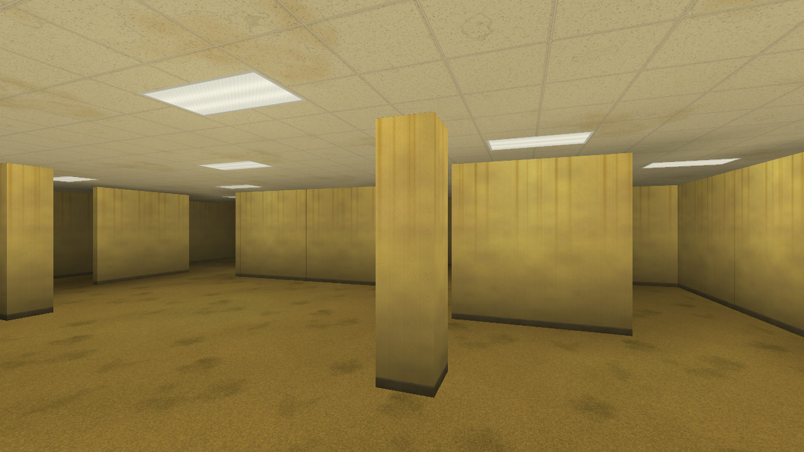
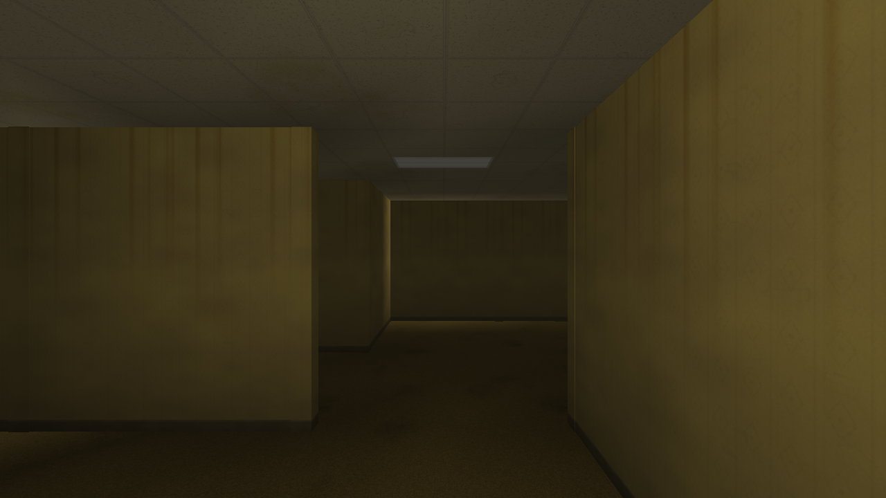
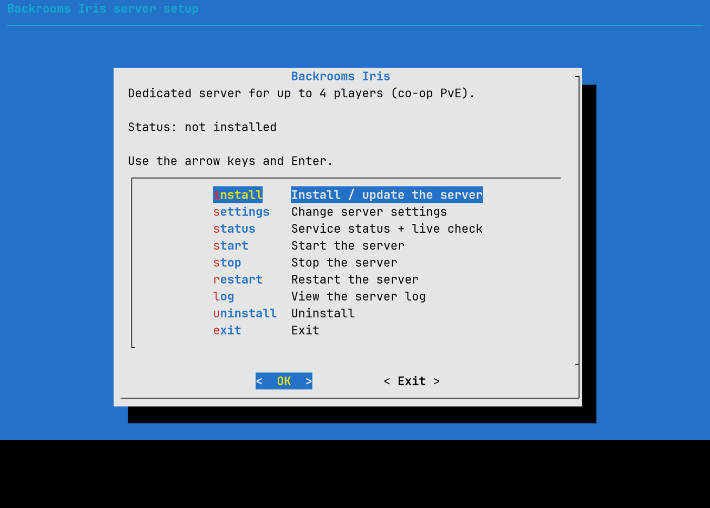

# Backrooms Iris

Open-source co-op Backrooms horror. Up to 4 players, PvE: survive, avoid the entities, find the exits.
One C++ codebase for **Linux, Windows and PS Vita**, plus a headless dedicated server for **FreeBSD**.



> Inspired by Backrooms games and community lore. All code, art and sound are original and generated in code:
> no assets, names, maps or art from any other game.

## Status: milestone 1

| | |
|---|---|
| ✅ | Endless procedurally generated **Level 0**: rooms, pillar halls, mazes, long corridors |
| ✅ | Walk around on PC: WASD + mouse or gamepad, sprint with stamina, crouch, head bob |
| ✅ | Procedural textures (wallpaper, carpet, ceiling tiles, light panels), baked lighting with dead lights, fog |
| ✅ | Builds on Linux and Windows from the same CMake project |
| ✅ | Vita target + LiveArea art wired up (gets compiled and tested in milestone 2) |
| ✅ | Headless server skeleton + FreeBSD TUI installer (real netcode is milestone 4) |

| Milestone | |
|---|---|
| 1 | Walk around a procedurally generated Level 0 on PC ← **here** |
| 2 | Same build running on Vita (Vita3K, then hardware) |
| 3 | Lighting, fog, audio, vibes: flicker, film grain, VHS shaders, procedural sound |
| 4 | Dedicated server + LAN co-op |
| 5 | Online PC ↔ Vita crossplay, entities (Bacteria, Hounds, carpet moss), more levels |

## Screenshots

| | |
|---|---|
|  |  |
|  |  |
|  |  |

---

## Arch Linux

### 1. Install the tools

```bash
sudo pacman -S --needed base-devel git cmake ninja sdl2-compat mesa
```

`sdl2-compat` is Arch's SDL2 package now (it replaced `sdl2`). If pacman asks to replace `sdl2`, say yes.
NVIDIA users: your normal `nvidia` / `nvidia-open` driver is all you need.

### 2. Build

From the `backrooms-iris` folder:

```bash
cmake -S . -B build -G Ninja
```

```bash
cmake --build build
```

### 3. Play

```bash
./build/backrooms-iris
```

Optional: `ctest --test-dir build` runs the world-generation and movement tests.

---

## Windows (10 / 11)

### 1. Install MSYS2

Download and run the installer from <https://www.msys2.org>, keep the default folder (`C:\msys64`).

### 2. Install the tools

Open **"MSYS2 UCRT64"** from the Start menu (that exact one) and run:

```bash
pacman -S --needed git mingw-w64-ucrt-x86_64-gcc mingw-w64-ucrt-x86_64-cmake mingw-w64-ucrt-x86_64-ninja mingw-w64-ucrt-x86_64-SDL2
```

### 3. Build

Go to the project folder. Windows drives are under `/c/`, for example:

```bash
cd /c/Users/BigG/Downloads/backrooms-iris
```

```bash
cmake -S . -B build -G Ninja
```

```bash
cmake --build build
```

### 4. Play

```bash
./build/backrooms-iris.exe
```

`SDL2.dll` gets copied next to the `.exe` automatically. To play on another PC, copy both files.

<details>
<summary>Visual Studio 2022 instead of MSYS2</summary>

```bat
git clone https://github.com/microsoft/vcpkg C:\vcpkg
C:\vcpkg\bootstrap-vcpkg.bat
C:\vcpkg\vcpkg install sdl2:x64-windows
cmake -S . -B build -DCMAKE_TOOLCHAIN_FILE=C:/vcpkg/scripts/buildsystems/vcpkg.cmake
cmake --build build --config Release
build\Release\backrooms-iris.exe
```
</details>

---

## PS Vita (for milestone 2)

The Vita build target is ready but hasn't been compiled yet. Getting it running is milestone 2.

### 1. Install VitaSDK (on Arch)

```bash
sudo pacman -S --needed base-devel cmake git curl python
```

```bash
git clone https://github.com/vitasdk/vdpm && cd vdpm
```

```bash
./bootstrap-vitasdk.sh
```

```bash
echo 'export VITASDK=/usr/local/vitasdk' >> ~/.bashrc && echo 'export PATH=$VITASDK/bin:$PATH' >> ~/.bashrc && source ~/.bashrc
```

```bash
./install-all.sh
```

`install-all.sh` installs every VitaSDK library, including **vitaGL** and **SDL2**.

### 2. Build the .vpk

Back in the `backrooms-iris` folder:

```bash
cmake -S . -B build-vita -DCMAKE_TOOLCHAIN_FILE=$VITASDK/share/vita.toolchain.cmake
```

```bash
cmake --build build-vita
```

Output: `build-vita/BackroomsIris.vpk`.

### 3. Run it

- **Vita3K**: install `vita3k-bin` from the AUR (or the AppImage from vita3k.org), install the firmware, then
  File → Install .pkg/.zip/.vpk.
- **Real Vita**: copy the `.vpk` with VitaShell (FTP or USB) and install it.
  vitaGL apps usually need `libshacccg.suprx` on the console. If it crashes at boot, install that with
  [ShaRKF00D](https://github.com/Rinnegatamante/ShaRKF00D) first.

---

## FreeBSD dedicated server (your X230)

The server is headless (no SDL, no GL) and uses the same world-generation code as the game.
Right now it runs, ticks and answers status queries. Players join in milestone 4.

### 1. Get the code onto the server

```bash
pkg install git
```

```bash
git clone <your repo url> backrooms-iris && cd backrooms-iris
```

(or copy the folder over with `scp -r`)

### 2. Run the installer as root

```bash
su -m root -c 'sh server/freebsd/install.sh'
```

(`sudo sh server/freebsd/install.sh` works too if you have sudo.)

It's a TUI (bsddialog, which ships in FreeBSD 14's base system). Pick **Install / update** and it will:

1. `pkg install cmake ninja` if they're missing (clang is already in base)
2. ask for the server name, UDP port, max players, world seed, tick rate and start-on-boot
3. build `iris_server` from the checkout
4. install the binary, config, rc.d service, log rotation and an unprivileged `iris` user
5. start the service and check that it answers

Run it again any time to update, change settings, start/stop, read the log, or uninstall.

### 3. Day-to-day

```bash
service iris_server status
```

```bash
service iris_server restart
```

```bash
tail -f /var/log/iris_server.log
```

Check it from any machine that has a build of the server:

```bash
iris_server --query <x230-ip>:27315
```

| file | what |
|---|---|
| `/usr/local/etc/iris/server.conf` | settings (restart after editing) |
| `/usr/local/etc/rc.d/iris_server` | service script (a crash means auto-restart after 5 s) |
| `/var/log/iris_server.log` | log, rotated by newsyslog |

For online play, forward **UDP 27315** on your router to the X230. If `pf` is enabled, the installer shows you the rule to add.

---

## Controls

| action | keyboard + mouse | gamepad | PS Vita |
|---|---|---|---|
| move | WASD / arrows | left stick | left stick |
| look | mouse | right stick | right stick |
| sprint | Shift | R / R2 / click left stick | R |
| crouch | Ctrl or C (hold) | B / Circle (toggle) | Circle (toggle) |
| fullscreen | F11 or Alt+Enter | | |
| screenshot | F12 | | |
| debug info | F3 (prints to the terminal) | Select | Select |
| release mouse / quit | Esc / Esc again | | |

Sprinting drains stamina (bar at the bottom). Run it dry and you're exhausted until it refills a bit.

## Command line

```
backrooms-iris [--seed N] [--width W --height H] [--fullscreen] [--no-vsync]
```

The same seed always gives the same world, on every platform.

## Reporting bugs

Paste these when something's off:

1. what you did and what looked or felt wrong
2. the terminal output (run the game from a terminal; press **F3** to add fps + position lines)
3. the seed (printed at startup) and a screenshot (**F12**, saved to `~/.local/share/BackroomsIris/BackroomsIris/`
   on Linux, `%APPDATA%\BackroomsIris\BackroomsIris\` on Windows)

## How it's built

```
src/core/       shared by everything, no SDL/GL: world generation, collision, player movement
src/client/     game: procedural textures, chunk meshing + baked light, renderer, main loop
src/platform/   pc/ (SDL2 + OpenGL) and vita/ (vitaGL + SDL2 input), shared gamepad code
src/server/     headless dedicated server (POSIX)
server/freebsd/ install.sh TUI, rc.d script, sample config, newsyslog rule
vita/sce_sys/   LiveArea images (regenerate: python3 tools/gen_livearea.py build/backrooms-iris)
tests/          core tests (ctest)
cmake/          MinGW toolchain for cross-compiling the Windows build from Linux
```

- **The world isn't stored anywhere.** Every wall, pillar and light is a pure function of `(seed, grid position)`,
  so chunks generate in any order, there are no seams, and the server knows the exact same walls as every client.
- **Movement is a pure function** `(state, input, dt) -> state` in `src/core`. That's what lets the server be
  authoritative while clients predict their own movement (milestone 4).
- **One renderer for PC and Vita**: it sticks to the OpenGL subset vitaGL implements (fixed function + VBOs + fog).
  Shaders arrive in milestone 3.

## License

MIT, see [LICENSE](LICENSE).
