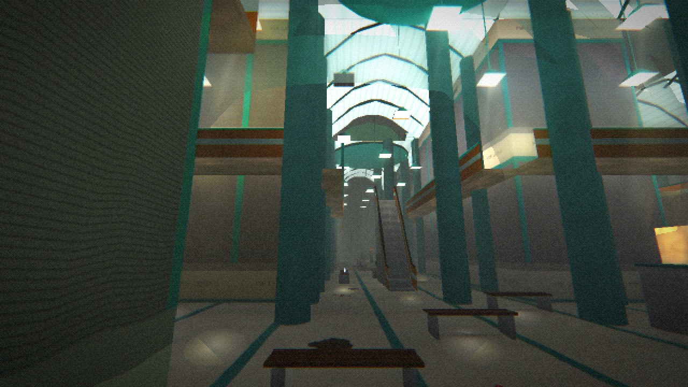
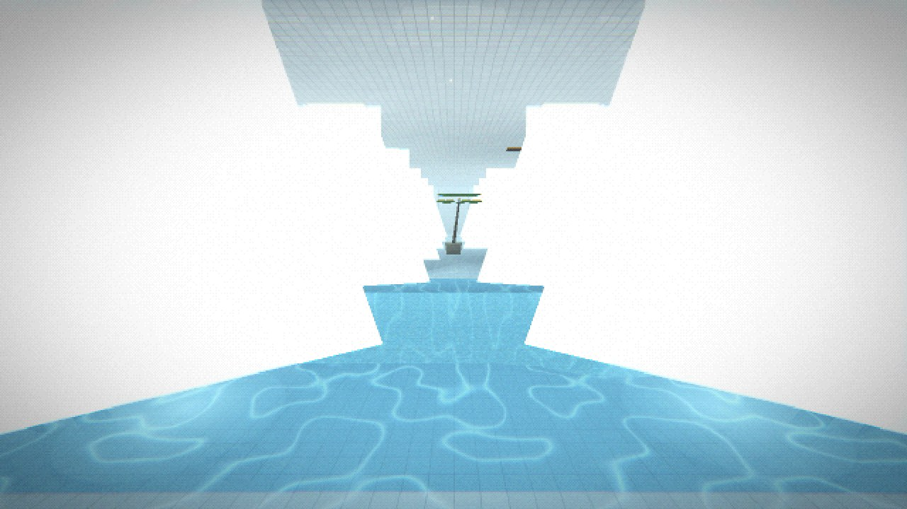
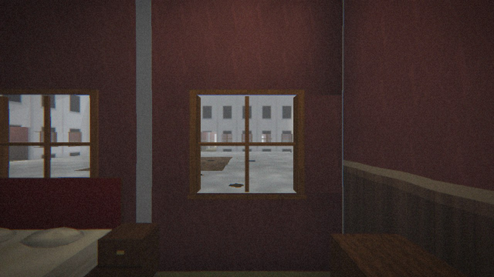
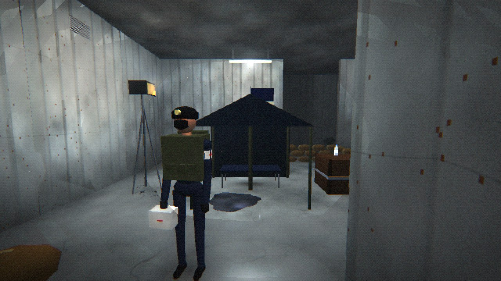
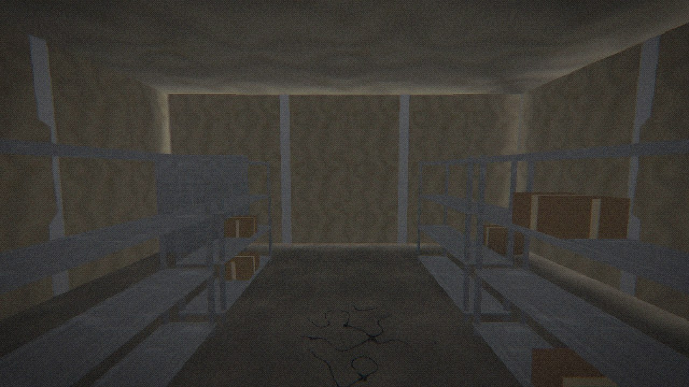
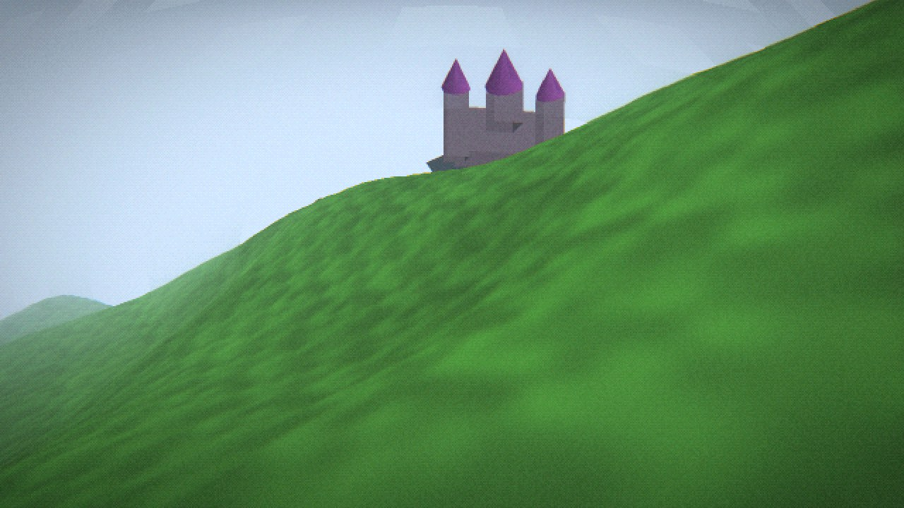
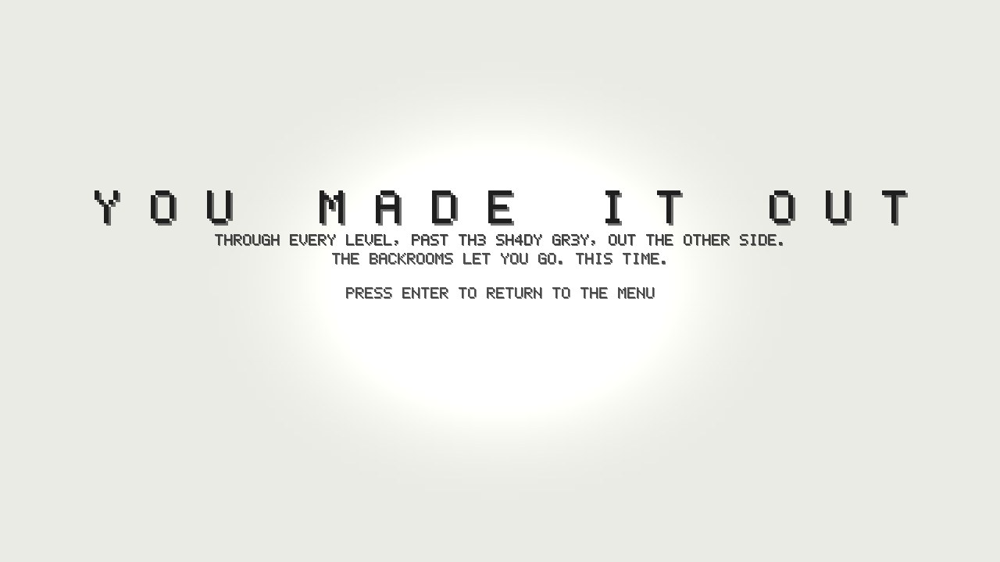
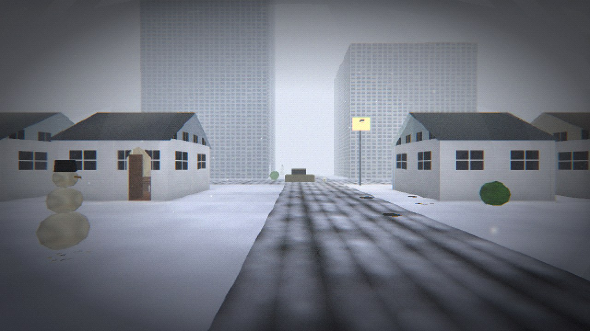
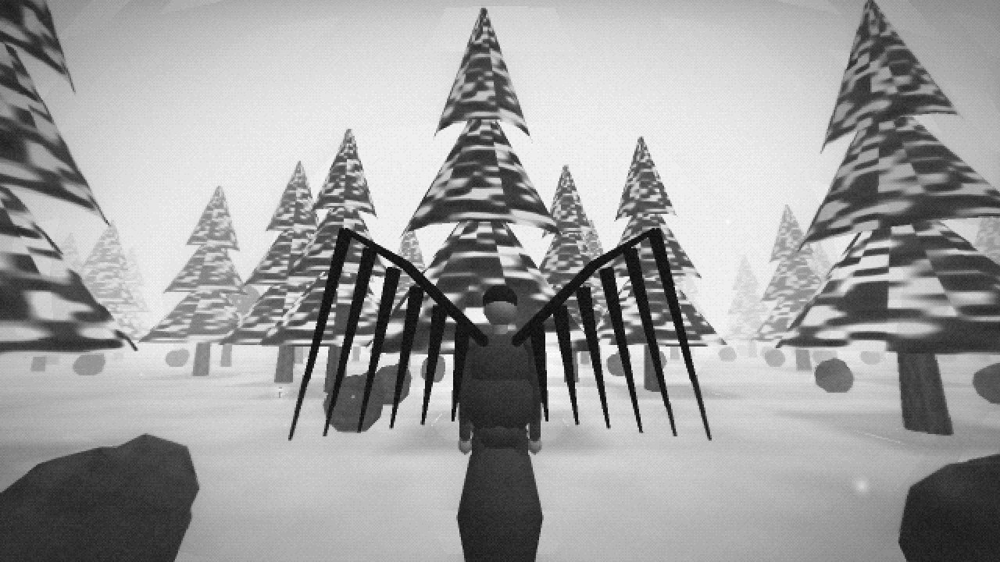
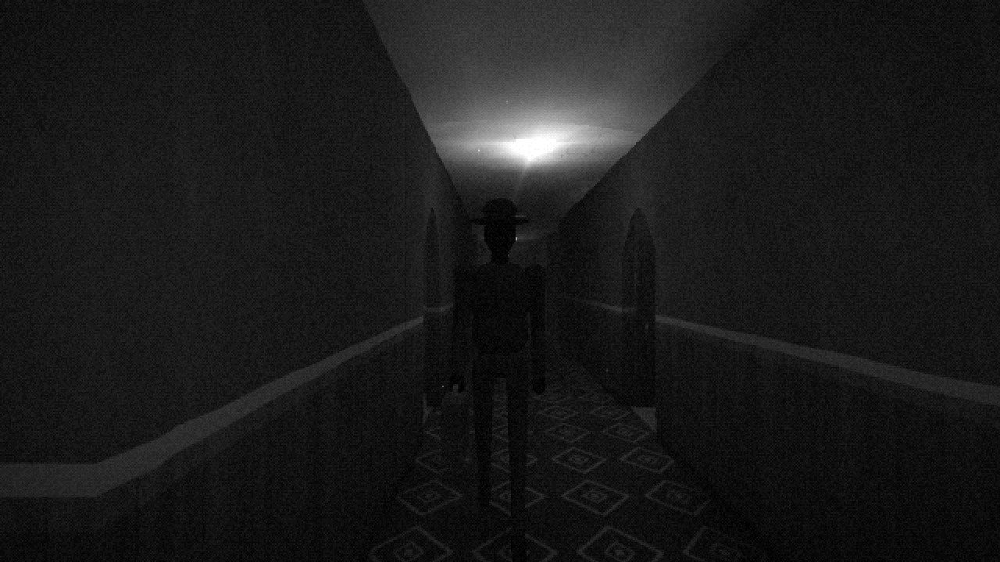

# Backrooms Iris

A co-op Backrooms horror game. You wake up somewhere you shouldn't be, and the goal is to keep your head
together, find the way out and not get caught on the way. Play alone, or with up to three friends on PC.
There's a single player version for the PS Vita too.



Runs on Linux, Windows and PS Vita. Multiplayer is PC only.

## What's in it

- 34 levels plus a lobby. They're endless and generated from a seed, so the same seed always builds the same
  world. A few have a day and night cycle.
- Buildings you can actually go into: hotel rooms, apartments, houses, shops, offices and diners, all furnished.
- 12 entities. Ten of them want you dead, and each one hunts in its own way. The other two are M.E.G. staff,
  and they're on your side.
- 28 items, including a shotgun if you're lucky enough to find one (and the shells for it).
- Objectives on every level. On some of them the exits stay locked until you've done the job.
- Four difficulties, from Easy to Nightmare.
- A sandbox mode where you can spawn anything, in single player or with friends.
- Co-op for up to 4 people. One of you hosts from inside the game and the others join, over your home network,
  over Tailscale or through a forwarded port. You can put a password on it.
- A PS1-style look with film grain, an optional camcorder filter and night vision. Graphics presets go from
  Low to Ultra, and the Vita gets a Normal and an Enhanced mode.
- All the sound and music is generated by the game itself, with sound that's positional and muffled by walls.

## New in 1.2

- **You can finish the game now.** Get through TH3 3ND and you've made it out, with a proper ending screen. In
  single player you go back to the menu. In multiplayer everyone goes back to the lobby.
- **A lobby for multiplayer.** It's a M.E.G. base where everyone meets up. The host picks the level and the
  difficulty from the pause menu, and can turn on sandbox mode for the whole group.
- **M.E.G. outposts.** You'll find tents, crates and sandbags on a lot of levels, each staffed by a medic and a
  scout. The medic patches you up and hands out supplies. The scout tells you where the nearest exit is, then
  walks part of the way with you and shoots anything that comes too close.
- **The Poolrooms rebuilt.** The pools have real depth and you can wade in or swim. Everything is rounded off,
  and there are slides, loungers, inflatable rings, palms and lifeguard chairs.
- **Level 188 rebuilt.** Every courtyard is ringed by a hotel. You can walk the corridors, go into the rooms
  and look out of their windows at the courtyard.
- **Walk-in cities.** On Level 11 and in 4Four, some buildings are open: corner shops, flats, offices and diners.
- **Motion's hills are real.** They're big rolling hills you can climb, not blocks in the way.
- **The mall looks like an abandoned 1990 downtown mall.** It has glass vaults on teal steel, an upper
  gallery, dead escalators, a food court and rows of shuttered shops.
- **Harder.** There are more entities, and they drift toward you even when they haven't seen you. They can't
  come near where you arrive on a level, though, so you always get a moment to breathe.
- **Level ! is brutal now.** More of them are behind you, a few wait in the dark up ahead, and there's more in
  your way.
- **Items are left somewhere believable.** You'll find them on desks, tables, shelves and beds, not floating in
  the middle of a hallway. Furniture is worth searching. Empty corridors mostly aren't.
- **Music** for the menu, the quiet places and Level !, with its own volume slider.
- **Vita Enhanced mode:** soft shadows under everything, and lamps reflected in shiny floors and pools.
- Menus work properly with a mouse now. You can click, drag sliders, scroll with the wheel and right click to
  go back.
- Fixed buildings in 4Four tearing open into the void.

| | |
|---|---|
|  |  |
|  |  |
|  |  |
|  |  |
|  |  |

## Download

The builds are in [`dist/`](dist):

- **Windows:** [`backrooms-iris-1.2-windows-x64.zip`](dist/backrooms-iris-1.2-windows-x64.zip). Unzip it and run
  `backrooms-iris.exe`. Keep `SDL2.dll` in the same folder.
- **Linux:** [`backrooms-iris-1.2-linux-x86_64.tar.gz`](dist/backrooms-iris-1.2-linux-x86_64.tar.gz). Untar it and
  run `./backrooms-iris`. You need SDL2 and OpenGL (`sdl2-compat` and `mesa` on Arch).
- **PS Vita:** [`backrooms-iris-1.2-vita.vpk`](dist/backrooms-iris-1.2-vita.vpk). Install it with VitaShell. The
  console needs `libshacccg.suprx`, which you can extract with ShaRKF00D.

Every push to GitHub also builds a fresh `.vpk`. It's in the Actions tab, under the latest **Vita VPK** run.

## How to play

Each level has exit doors set into the walls, each with a small green EXIT sign above it. Find one and walk
through, and everyone moves on to the next level. If a level says the exits are locked, finish its objective
first. Your sanity drops in the dark and when entities are around, so keep some almond water on you. When you
die you drop everything you were carrying. In co-op you come back after 10 seconds.

If you see a M.E.G. tent, go say hi.

### Levels

Most of them come from the Backrooms wiki, in our own take:

0 The Lobby, 1 Habitable Zone, 2 Pipe Dreams, 3 Electrical Station, 4 Abandoned Office, 5 Terror Hotel,
6 Lights Out, 7 Thalassophobia, 8 Cave System, 9 The Suburbs, 10 Bumper Crop, 11 The Endless City,
13 Infinite Apartments, 19 The Attic, 21 Numbered Doors, 22 The Car Park, 24 The Moon, 33 The Infinite Mall,
36 Airport, 37 Sublimity (the Poolrooms, and safe), 51 The Forgotten City, 70 Froidetown, 94 Motion,
188 Courtyard of Windows, Level Fun =), Level ! (Run For Your Life), and TH3 SH4DY GR3Y: 0Zero, 1One, 2Two,
3Three, 4Four, L0ST H0P3, 2 F4R and TH3 3ND, which is the end.

### Entities

| | how it hunts | how to survive it |
|---|---|---|
| **Bacteria** | freezes when it spots you, then runs you down. It's fast but turns slowly | break line of sight around corners and through doorways |
| **Hound** | hunts by sound. Sprinting is loud, crouching is almost silent | face it and don't run. Turn your back and it lunges |
| **Smiler** | a grin in the dark that creeps closer while you're not looking | don't stare and don't sprint. Get to the light. Flashlights hurt it |
| **Skin-Stealer** | patrols, chases on sight and hits hard | sprint, or drink an energy drink |
| **Partygoer** | `=)` slow, but it never stops following | keep moving and find the exit |
| **The Landlord** | a shadow in a suit patrolling 1One. Nothing hurts him | be quiet and keep moving through the doors |
| **Faceling** | 4Four's muggers, who take something and leave | hand over almond water and they'll leave you alone |
| **The Mangled** | taller than the buildings, and slow | don't be where it steps |
| **Animation** | Motion's cartoons. They come out at night and move in stop-motion bursts | get indoors and wait for the sun |
| **Fallen angel** | 2Two's angels. They're harmless | ask one to push you through |
| **M.E.G. medic** | stays at the outpost | talk to them (E / Cross) to get patched up |
| **M.E.G. scout** | stays at the outpost until you ask | talk to them for directions and an escort |

### Items

| | | | |
|---|---|---|---|
| **Almond Water** | stamina and calm | **Super Almond Water** | heals body and mind |
| **Energy Drink** | fast for a while | **Memory Juice** | fast and unkillable, until it kills you |
| **Royal Ration** | heals | **Med Kit** | heals a lot |
| **Moth Jelly** | slow heal over time | **Painkillers** | half damage for 30 s |
| **Liquid Pain** | hurts, but clears your head | **Cashew Water** | cures memory juice and slows you |
| **Lucky O' Milk** | they stop noticing you | **Liquid Silence** | 30 s of total silence |
| **Firesalt** | throw it and the fire keeps them away | **Flash Bulb** | throw it and the flash stuns them |
| **Glow Stick** | drop it for 3 minutes of green light | **Music Box** | throw it and they go to the music |
| **Flashlight** | light (F / Triangle) | **Batteries** | a full flashlight right now |
| **Night Vision** | see in the dark (uses the battery) | **Crowbar** | swing it to stun |
| **Compass** | hold it and it roughly points to an exit | **Radio** | static gets louder when they're near |
| **Chalk** | mark the floor so you stop walking in circles | **Rabbit's Foot** | saves you from dying once |
| **Shotgun** | rare. Eight pellets, short range | **Shotgun Shells** | rarer than you'd like |
| **Pistol / Rifle** | sandbox only | | |

### Controls

| action | keyboard and mouse | gamepad / PS Vita |
|---|---|---|
| move / look | WASD / mouse | left stick / right stick |
| sprint | Shift | R / R2 |
| crouch | Ctrl or C (hold) | Circle / B (toggle) |
| pick up, talk | E | Cross / A |
| use item, swing, shoot | left click or Q | Square / L / D-pad up |
| pick an item | 1-9 or mouse wheel | D-pad left / right |
| flashlight | F | Triangle |
| sandbox spawn menu | Tab | Select |
| pause (the host's lobby menu is here too) | Esc | Start |
| screenshot / fullscreen | F12 / F11 | |

In the menus you can also click, drag sliders, scroll with the mouse wheel and right click to go back.

## Multiplayer (PC)

One player hosts from inside the game and their PC runs it for everyone. Friends connect straight to that PC,
up to 4 players including the host. You don't need to rent or run a server.

1. The host goes to **Multiplayer → Host Game**. Pick a difficulty and, if you want, a password. With
   **Start in the lobby** on, everyone meets at the M.E.G. base first, and the host picks the level from the
   pause menu when the group is ready. Then press **Start Hosting**.
2. Friends go to **Multiplayer → Join Game**. Games on your network and your tailnet show up in the list.
   You can also type the host's address (and the password, if there is one) and press **Connect**.

When someone makes it out through TH3 3ND, everyone is sent back to the lobby for another run.

How friends can reach the host:

| | what to do | address to type |
|---|---|---|
| **Same network** | nothing | it shows up in the list (or type the host's LAN IP) |
| **Tailscale** (easiest online) | everyone installs [Tailscale](https://tailscale.com) and joins the same tailnet | it shows up in the list (or `100.x.y.z` / the machine name) |
| **Port forwarding** | the host forwards **UDP 27315** (or the port set on the Host screen) on their router to their PC | the host's public IP, like `203.0.113.7` or `203.0.113.7:27316` |

The first time you host, Windows asks about firewall access. Allow it.

**Keeping strangers out.** Nobody can join unless someone is hosting, and only while they are.

- If you forward a port, set a password. The password itself never goes over the network.
- Joining takes a two-step handshake, so someone faking their address can't grab a slot or aim traffic at
  someone else.
- The replies used by the Join list are never bigger than the request, so a host can't be abused to flood
  someone.
- Only the host's own game can change levels. Everything the game receives is bounds-checked, and the packet
  code is fuzz-tested.

Tailscale is still the most private option, because nothing is exposed to the internet at all.

## Building it yourself

### Linux (Arch)

```bash
sudo pacman -S --needed base-devel git cmake ninja sdl2-compat mesa
```
```bash
cmake -S . -B build -G Ninja
```
```bash
cmake --build build
```
```bash
./build/backrooms-iris
```

`ctest --test-dir build` runs the tests. They cover every level, the sim, items, real UDP play and the host's
defences.

### Windows (MSYS2)

Install [MSYS2](https://www.msys2.org), open **MSYS2 UCRT64**, then:

```bash
pacman -S --needed git mingw-w64-ucrt-x86_64-gcc mingw-w64-ucrt-x86_64-cmake mingw-w64-ucrt-x86_64-ninja mingw-w64-ucrt-x86_64-SDL2
```
```bash
cmake -S . -B build -G Ninja
```
```bash
cmake --build build
```

All you need to play is `build/backrooms-iris.exe` and `SDL2.dll`. You can also cross-compile from Linux with
`cmake/mingw-w64-x86_64.cmake`.

### PS Vita

The Vita build is single player and has no network code in it. You need [VitaSDK](https://vitasdk.org):

```bash
git clone https://github.com/vitasdk/vdpm && cd vdpm && ./bootstrap-vitasdk.sh
```
```bash
export VITASDK=/usr/local/vitasdk && export PATH=$VITASDK/bin:$PATH
```
```bash
./install-all.sh
```

Then, from this folder:

```bash
cmake -S . -B build-vita -DCMAKE_TOOLCHAIN_FILE=$VITASDK/share/vita.toolchain.cmake -DCMAKE_BUILD_TYPE=Release
```
```bash
cmake --build build-vita
```

That gives you `build-vita/BackroomsIris.vpk`. If you'd rather not set any of that up, push to GitHub and the
**Vita VPK** workflow builds it for you. The console needs `libshacccg.suprx` (extract it with ShaRKF00D).
[BUILD_VPK.md](BUILD_VPK.md) covers the details, the crash log and safe mode.

## Settings and fiIes

Settings and screenshots (F12) are saved here. On the Vita, `log.txt` and `boot.txt` are saved here too.

- **Linux:** `~/.local/share/BackroomsIris/BackroomsIris/`
- **Windows:** `%APPDATA%\BackroomsIris\BackroomsIris\`
- **Vita:** `ux0:data/BackroomsIris/`

Command line: `backrooms-iris [--level N] [--seed N] [--difficulty easy|medium|hard|nightmare] [--sandbox]
[--host] [--join IP[:PORT]] [--password PW]`. `--help` lists the rest.

## How it's put together

```
src/core/       level generation, collision, movement, entities, items, the game sim, the wire format (no SDL or GL)
src/net/        UDP sockets, the in-game host, the joining client (PC only)
src/client/     menus and HUD, sessions, the renderer, generated textures / models / sound / music, Tailscale discovery
src/platform/   pc/ (SDL2 + OpenGL) and vita/ (vitaGL + SDL2)
tests/          the ctest suite
vita/sce_sys/   LiveArea images (python3 tools/gen_livearea.py regenerates them)
```

- Levels aren't stored anywhere. Every wall, room, light, item and exit is worked out from the level, the seed
  and the position, so the same seed gives everyone the same world.
- There's one simulation. `GameSim` runs single player on your machine and multiplayer on the host. Joiners
  predict their own movement with the same code and catch up when the host's update arrives.
- There's one renderer for PC and Vita, using the part of OpenGL that vitaGL supports. The PC adds a few
  optional post effects on top.

## License

MIT, see [LICENSE](LICENSE).
