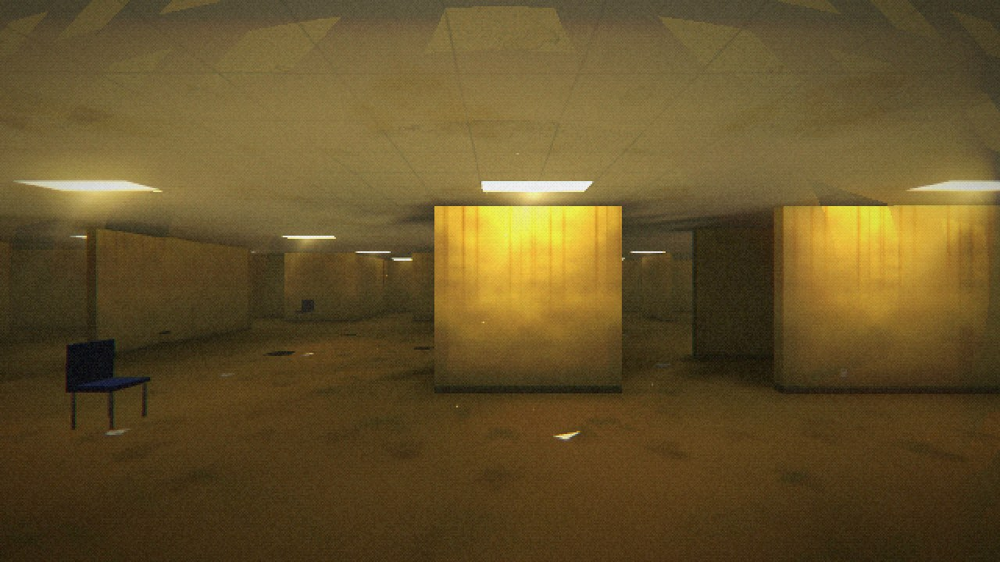
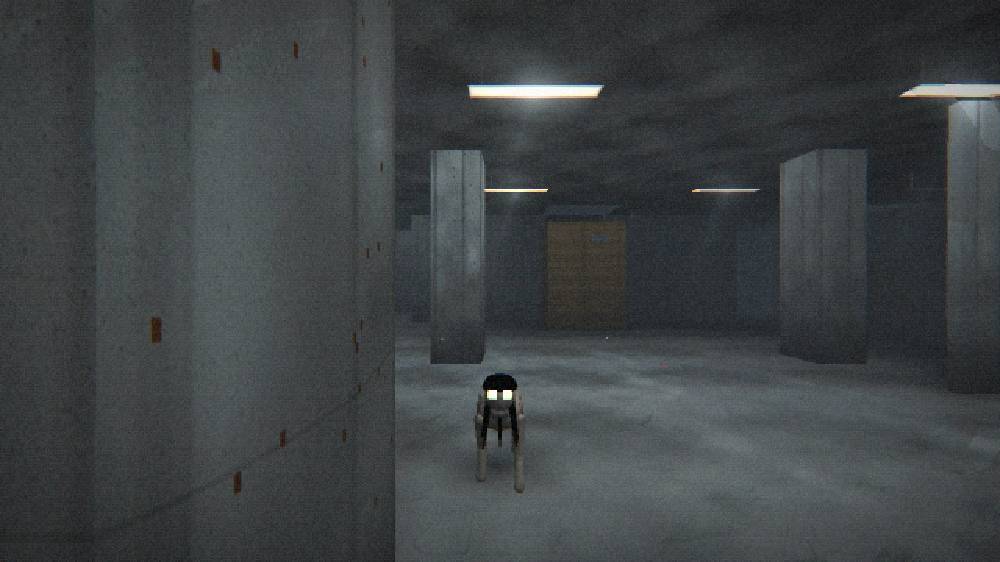
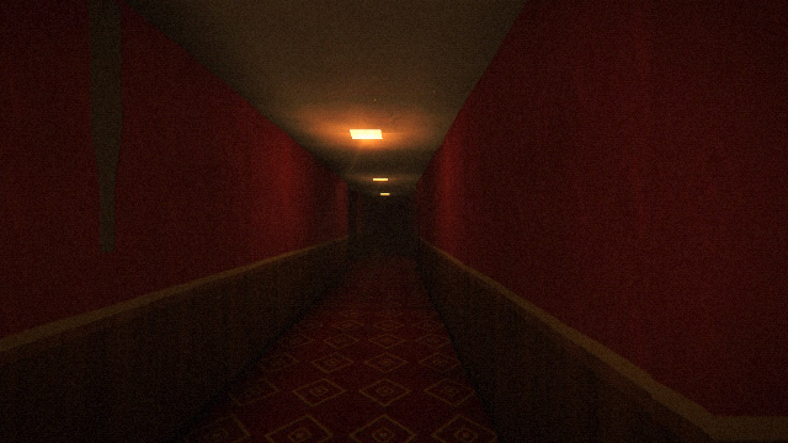
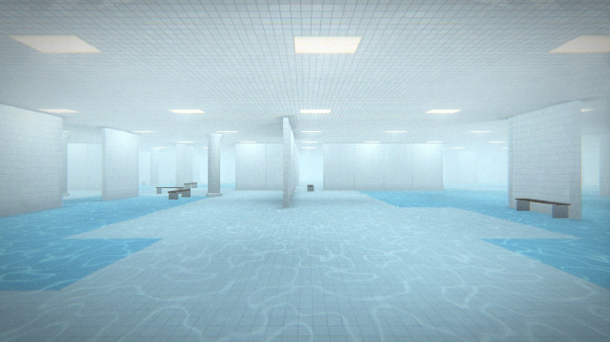
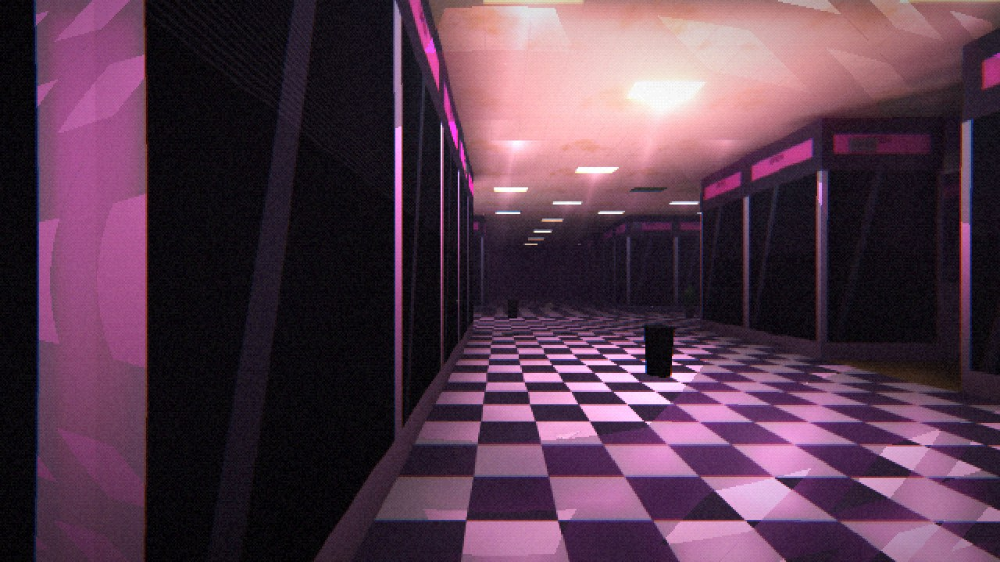
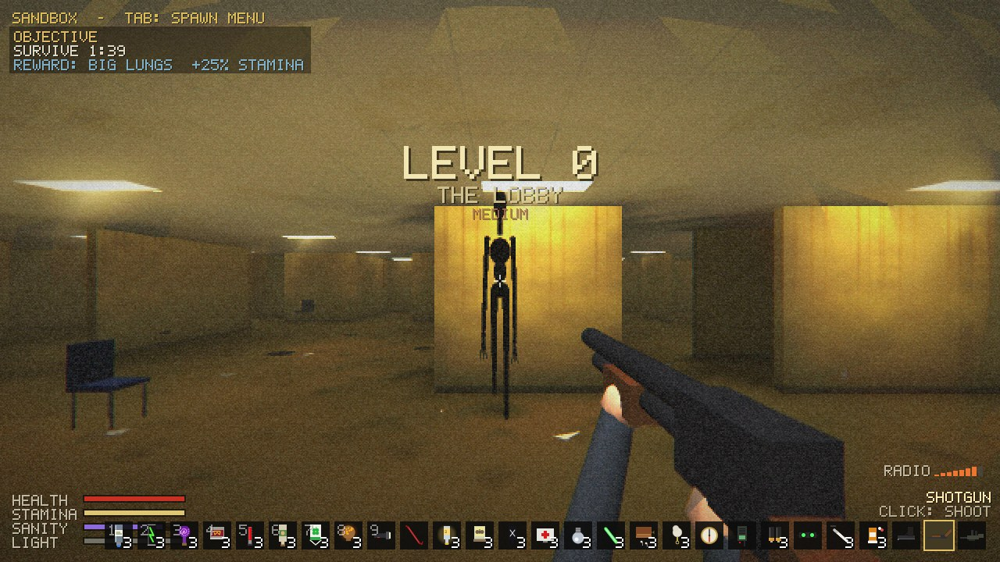
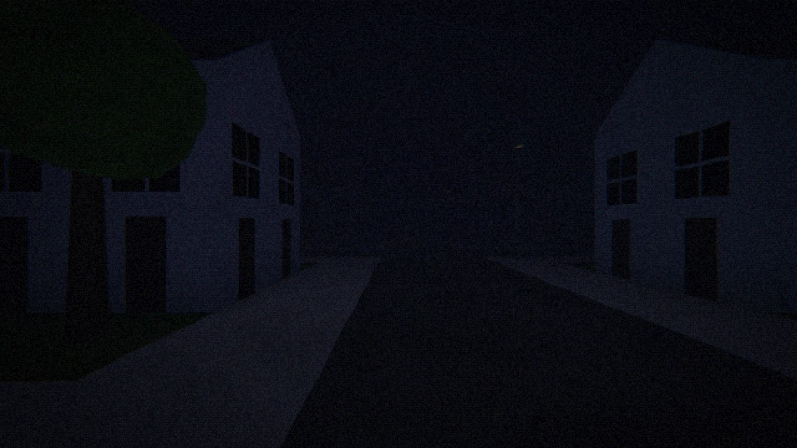

# Backrooms Iris

Open-source co-op Backrooms horror. Survive, keep your head together, find the exit, and don't get found.
Up to 4 players on PC (one of you hosts, no servers involved), and single player on PS Vita.



> Inspired by Backrooms games and the community wiki lore. Every texture, model and sound is original and
> generated in code: no assets, maps, art or audio copied from any other game.

**Platforms:** Linux, Windows (multiplayer + single player), PS Vita (single player).

## Features

- **27 endless levels**, generated from a seed, so the same seed gives the same world everywhere.
- **5 entities** that each hunt differently, and **27 items** (24 to find + 3 sandbox guns).
- **Objectives** on every level that reward the whole run with a perk.
- **Difficulties:** Easy, Medium, Hard, Nightmare.
- **Sandbox mode:** spawn entities, items and weapons, and toggle god mode / noclip.
- **Co-op for up to 4 players:** host from inside the game, friends join over LAN, Tailscale or a forwarded port.
  You can set an optional password.
- **Look:** PS1-style visuals, film grain, an optional camcorder look, and night vision.
- **Sound:** fully procedural, positional and muffled through walls.

| | |
|---|---|
|  |  |
|  |  |
|  |  |

## Download

Grab the latest build from the Releases page:

- **Windows:** unzip and run `backrooms-iris.exe` (keep `SDL2.dll` next to it).
- **Linux:** untar and run `./backrooms-iris`. Needs SDL2 and OpenGL (`sdl2-compat` + `mesa` on Arch).
- **PS Vita:** build the `.vpk` yourself (see [Building](#building)). Releases don't ship one.

## How to play

Find the **EXIT** door. It's set into a wall somewhere, with a small green sign over it. Walk through it and
everyone goes to the next level. Your **sanity** drains in the dark and near entities, so drink almond water.
Dying drops your items. In co-op, dead players come back after 10 seconds.

### Levels

0 The Lobby, 1 Habitable Zone, 2 Pipe Dreams, 3 Electrical Station, 4 Abandoned Office, 5 Terror Hotel,
6 Lights Out, 7 Thalassophobia, 8 Cave System, 9 The Suburbs, 10 Bumper Crop, 11 The Endless City (safe),
13 Infinite Apartments, 19 The Attic, 21 Numbered Doors, 22 The Car Park, 24 The Moon, 33 The Infinite Mall,
36 Airport, 37 Sublimity (safe), 51 The Forgotten City, Level Fun =), Level ! (Run For Your Life), and
TH3 SH4DY GR3Y with its sub-levels B14CK, M4NS10N and L0ST H0P3.

You can walk into most of what you see: hotel rooms, apartments, offices behind numbered doors, mall shops,
wanderer camps.

### Entities

| | how it hunts | how to live |
|---|---|---|
| **Bacteria** | freezes when it spots you, then runs you down. Fast, but turns slowly | break line of sight: corners, doorways |
| **Hound** | hunts by **sound**: sprinting is loud, crouching is nearly silent | face it and don't run. Turn your back and it lunges |
| **Smiler** | a grin in the dark that drifts closer while you're not looking | don't stare, don't sprint, get to the light. Flashlights hurt it |
| **Skin-Stealer** | patrols the suburbs, chases on sight, hits hard | sprint, or an energy drink |
| **Partygoer** | `=)` slow, but it never stops following | keep moving, find the exit |

### Items

| | | | |
|---|---|---|---|
| **Almond Water** | stamina + calm | **Super Almond Water** | heals body and mind |
| **Energy Drink** | fast for a while | **Memory Juice** | fast and unkillable... then it kills you |
| **Royal Ration** | heals | **Med Kit** | heals a lot |
| **Moth Jelly** | slow heal over time | **Painkillers** | half damage for 30 s |
| **Liquid Pain** | hurts, clears your head | **Cashew Water** | cures memory juice, slows you |
| **Lucky O' Milk** | they stop noticing you | **Liquid Silence** | 30 s of total silence |
| **Firesalt** | throw: fire keeps them away | **Flash Bulb** | throw: a flash stuns them |
| **Glow Stick** | drop: 3 min of green light | **Music Box** | throw: they go to the music |
| **Flashlight** | light (F / Triangle) | **Batteries** | full flashlight right now |
| **Night Vision** | see in the dark (uses battery) | **Crowbar** | swing to stun |
| **Compass** | hold it: points roughly to a nearby exit | **Radio** | static gets louder when they're near |
| **Chalk** | mark the floor so you stop walking in circles | **Rabbit's Foot** | saves you from dying once |
| **Pistol / Shotgun / Rifle** | sandbox only | | |

### Controls

| action | keyboard + mouse | gamepad / PS Vita |
|---|---|---|
| move / look | WASD / mouse | left stick / right stick |
| sprint | Shift | R / R2 |
| crouch | Ctrl or C (hold) | Circle / B (toggle) |
| pick up / interact | E | Cross / A |
| use item, swing, shoot | left click or Q | Square / L / D-pad up |
| pick item | 1-9 or mouse wheel | D-pad left / right |
| flashlight | F | Triangle |
| sandbox spawn menu | Tab | Select |
| pause | Esc | Start |
| screenshot / fullscreen | F12 / F11 | |

## Multiplayer (PC)

There's no server to run and nothing central to connect to. One player **hosts** from inside the game, and their
PC runs the game for everyone. Friends **join** that PC directly. Up to 4 players, host included.

1. Host: **Multiplayer → Host Game**. Pick the level, the difficulty and (optionally) a **password**, then
   **Start Hosting**.
2. Friends: **Multiplayer → Join Game**. Games on your network and your tailnet show up in the list. Or type
   the host's address (and the password, if there is one) and press **Connect**.

How friends reach the host:

| | what to do | address to type |
|---|---|---|
| **Same network** | nothing | it shows up in the list (or the host's LAN IP) |
| **Tailscale** (easiest online) | everyone installs [Tailscale](https://tailscale.com) and joins the same tailnet | it shows up in the list (or `100.x.y.z` / the machine name) |
| **Port forwarding** | the host forwards **UDP 27315** (or the port set on the Host screen) on their router to their PC | the host's public IP, e.g. `203.0.113.7` or `203.0.113.7:27316` |

Windows asks about firewall access the first time you host: allow it.

**Safety.** Nobody can join unless someone is hosting, and only while they are. The host decides who gets in:

- If you forward a port, **set a password**. The password itself is never sent over the network.
- Joining needs a two-step handshake, so a stranger faking an address can't take a slot or point traffic at
  someone else.
- The status replies used by the Join list are never bigger than the request, so a host can't be used to
  amplify an attack.
- Everything a host or joiner receives is bounds-checked. The packet code is fuzz-tested.

Tailscale is still the most private option: nothing is exposed to the internet at all.

## Building

### Linux (Arch)

```bash
sudo pacman -S --needed base-devel git cmake ninja sdl2-compat mesa
```
```bash
cmake -S . -B build -G Ninja
```
```bash
cmake --build build
```
```bash
./build/backrooms-iris
```

`ctest --test-dir build` runs the tests: every level, the sim, items, real UDP play, and the host's defences.

### Windows (MSYS2)

Install [MSYS2](https://www.msys2.org), open **MSYS2 UCRT64**, then:

```bash
pacman -S --needed git mingw-w64-ucrt-x86_64-gcc mingw-w64-ucrt-x86_64-cmake mingw-w64-ucrt-x86_64-ninja mingw-w64-ucrt-x86_64-SDL2
```
```bash
cmake -S . -B build -G Ninja
```
```bash
cmake --build build
```

`build/backrooms-iris.exe` and `SDL2.dll` are all you need. From Linux you can also cross-compile with
`cmake/mingw-w64-x86_64.cmake`.

### PS Vita

Single player only (the Vita build contains no network code). Needs [VitaSDK](https://vitasdk.org):

```bash
git clone https://github.com/vitasdk/vdpm && cd vdpm && ./bootstrap-vitasdk.sh
```
```bash
export VITASDK=/usr/local/vitasdk && export PATH=$VITASDK/bin:$PATH
```
```bash
./install-all.sh
```

Then, from this folder:

```bash
cmake -S . -B build-vita -DCMAKE_TOOLCHAIN_FILE=$VITASDK/share/vita.toolchain.cmake -DCMAKE_BUILD_TYPE=Release
```
```bash
cmake --build build-vita
```

You get `build-vita/BackroomsIris.vpk`. Or push to GitHub and the **Vita VPK** workflow builds it for you.
On the console you need `libshacccg.suprx` (extract it with ShaRKF00D). [BUILD_VPK.md](BUILD_VPK.md) has the
details, the crash log and the safe mode.

## Settings and files

Settings and screenshots (F12) are stored in (the Vita also keeps `log.txt` and `boot.txt` there):

- **Linux:** `~/.local/share/BackroomsIris/BackroomsIris/`
- **Windows:** `%APPDATA%\BackroomsIris\BackroomsIris\`
- **Vita:** `ux0:data/BackroomsIris/`

Command line: `backrooms-iris [--level N] [--seed N] [--difficulty easy|medium|hard|nightmare] [--sandbox]
[--host] [--join IP[:PORT]] [--password PW]`. Run `--help` for the rest.

## How it's built

```
src/core/       no SDL/GL: level generation, collision, movement, entities, items, the game sim, wire format
src/net/        UDP sockets, the in-game host, the joining client (PC only)
src/client/     menus + HUD, sessions, renderer, procedural textures / models / sound, Tailscale discovery
src/platform/   pc/ (SDL2 + OpenGL) and vita/ (vitaGL + SDL2)
tests/          ctest suite
vita/sce_sys/   LiveArea images (python3 tools/gen_livearea.py regenerates them)
```

- **Levels aren't stored.** Every wall, room, light, item and exit is a pure function of `(level, seed, position)`.
- **One simulation.** `GameSim` runs single player locally and multiplayer on the host. Joiners predict their own
  movement with the same code and replay unacknowledged inputs when a snapshot arrives.
- **One renderer for PC and Vita:** the OpenGL subset vitaGL supports (fixed function, VBOs, fog). PC adds
  optional GLSL post effects.

## License

MIT, see [LICENSE](LICENSE).
